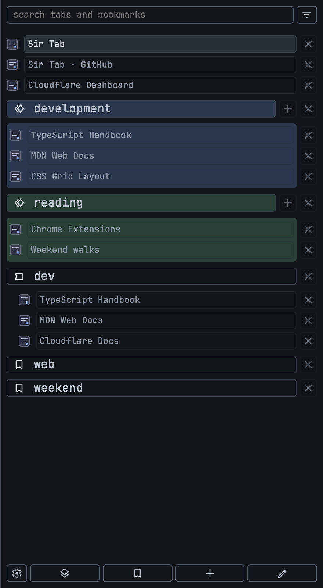
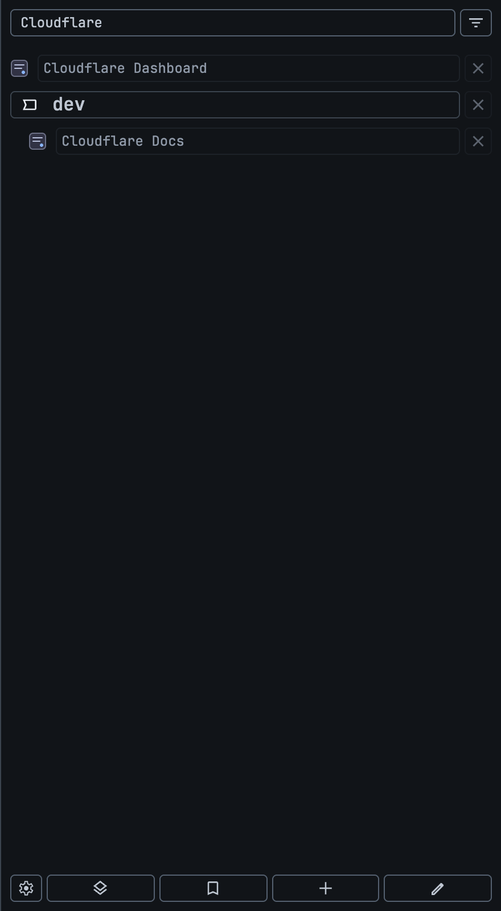
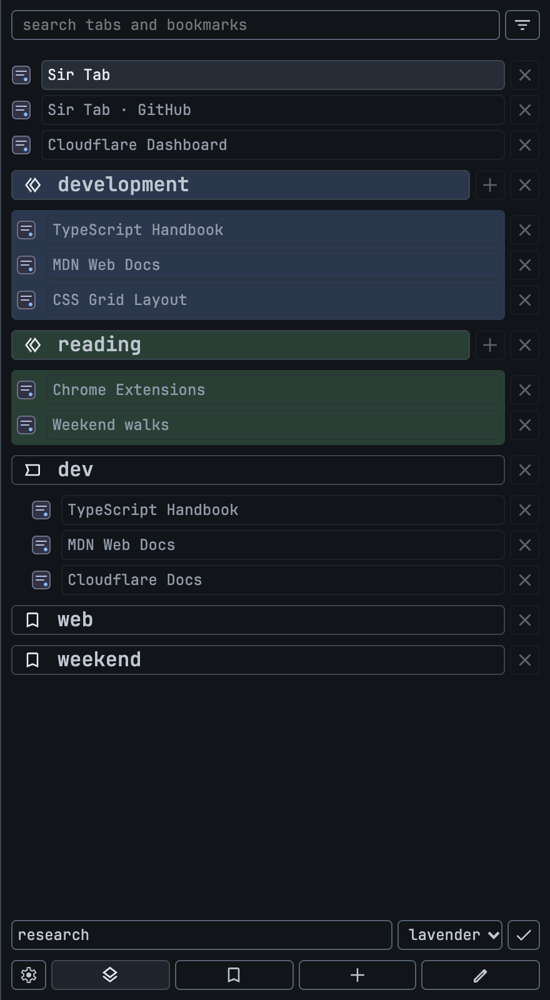
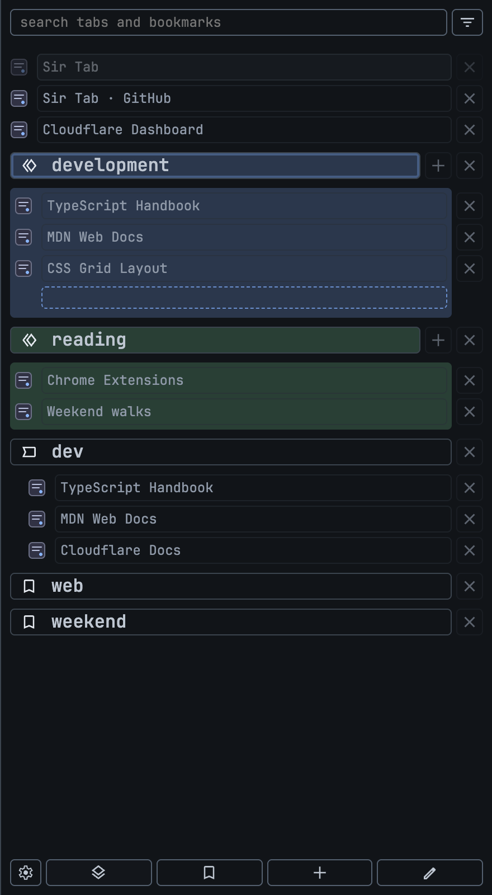
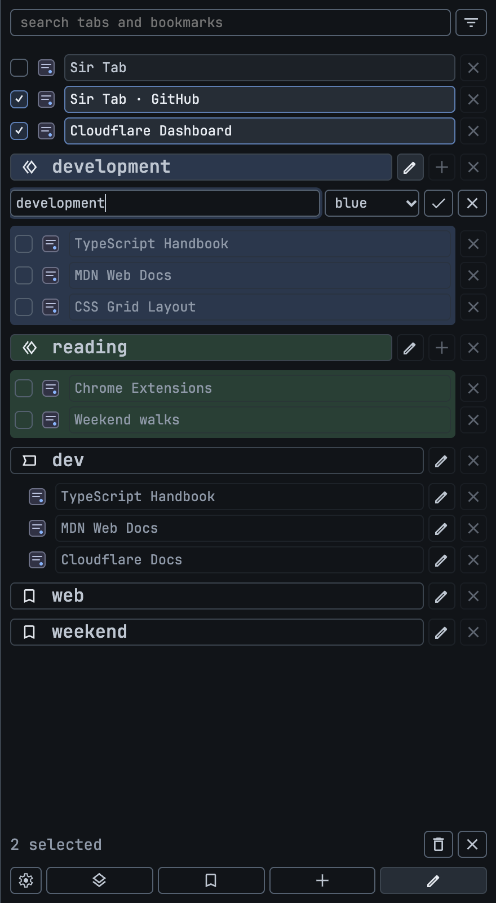
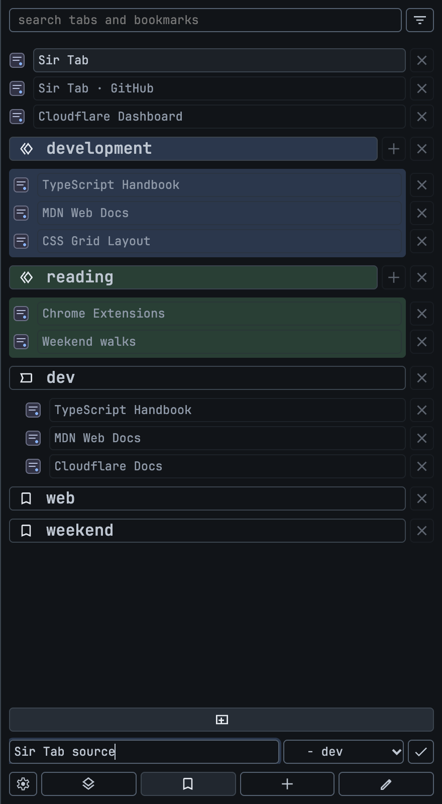
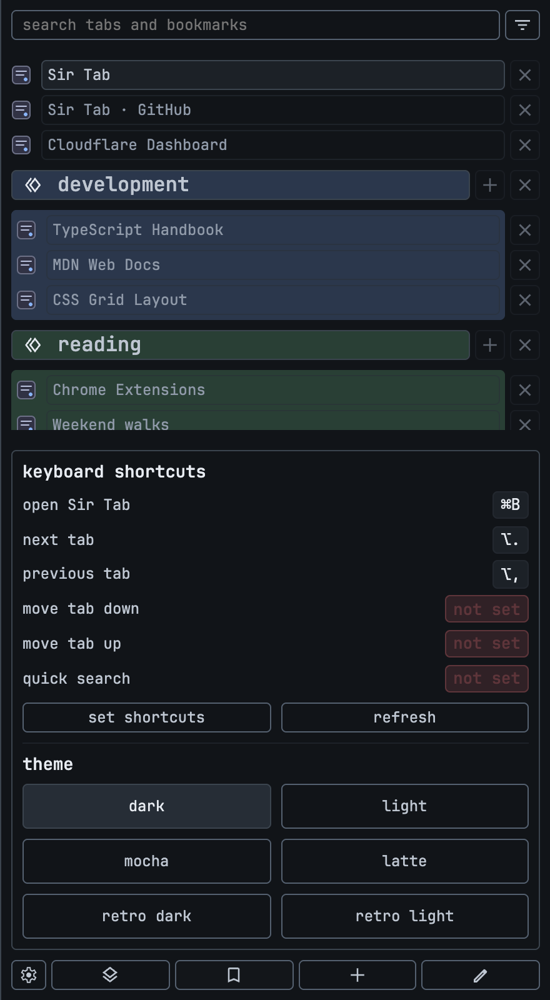

# Sir Tab

Sir Tab is a Chrome side-panel extension for managing tabs, tab groups, and
bookmarks from one place.



## Features

- View, switch, and organise tabs in the current browser window.
- Search tab and bookmark titles and addresses, plus group and folder names.
- Create colour-coded tab groups and drag individual or selected tabs between them.
- Arrange tabs and groups in a saved sidebar order, with restoration across browser restarts.
- Create bookmark folders, bookmark the current tab, and rename or delete bookmarks and folders.
- Select and close multiple tabs, with Shift-click range selection.
- Move between visible tabs and rearrange them with configurable keyboard shortcuts.
- Hide sidebar sections and choose from six built-in colour themes.

Sidebar ordering is saved separately from the browser's native tab-strip order.
Moving tabs between groups also changes their native browser group membership,
which may reposition them in the tab strip. Bookmarks are shown from the
bookmarks bar; Other Bookmarks, Mobile Bookmarks and managed system folders are hidden.

### Search tabs and bookmarks



### Create colour-coded groups



### Organise tabs with drag and drop



### Select and edit in batches



### Create bookmarks in folders



### Shortcuts and themes



## Installation and usage

Build the extension from source:

```bash
npm install
npm run build
```

1. Open `chrome://extensions` in Chrome 141+ or a compatible Chromium-based browser such as Brave.
2. Enable **Developer mode**, choose **Load unpacked**, and select this project's `dist/` directory.
3. Click Sir Tab's extension icon to open the side panel.
4. Open Sir Tab's settings and choose **set shortcuts** to configure `chrome://extensions/shortcuts`. Tab-reordering shortcuts have no default binding; review the assigned shortcuts for your browser.

The author's preferred setup is Brave with its native vertical tabs hidden.

## Privacy

Sir Tab processes browser data locally and saves preferences and sidebar order
in local extension storage, including URL-derived fingerprints for restoring
order. It has no developer-operated account, analytics or data-upload service.
Displaying browser-supplied favicons may contact their hosts. See the
[privacy policy](docs/privacy-policy.md) for details.

## Development

Watch TypeScript and static files during development:

```bash
npm run watch
```

Reload the unpacked extension after rebuilding to pick up changes.

Run the automated behavioural tests:

```bash
npm test
```

Run all browser interaction fixtures in Chrome or Brave:

```bash
npm run test:browser
```

Set `SIRTAB_TEST_PAGE=tests/refresh-interaction.html` to run one fixture.

Generate a coverage report for the modules exercised by the tests:

```bash
npm run test:coverage
```

Regenerate the README screenshots from the built extension's real UI:

```bash
npm run screenshots
```

This requires Brave or Chromium with support for loading unpacked extensions;
use `SIRTAB_BROWSER` to select a different executable. The screenshots show the
current sidebar at 440 × 800, using disposable demo tabs and bookmarks in an
isolated browser profile.

## Release preparation

Build a Chrome Web Store upload archive from the current source:

```bash
npm run package:store
```

The archive is written to `webstore/sir-tab-<version>.zip`. Its contents are
limited to the built extension files and exclude source maps. Review the
[privacy policy](docs/privacy-policy.md) and
[Store listing and disclosure draft](docs/chrome-web-store-listing.md) against
the release before submitting it. The policy must be publicly accessible at
the URL entered in the Chrome Web Store dashboard.

Project status: using and testing before submission to the Chrome Web Store.

## Support

- Repository: <https://github.com/mischamclaughlin/SirTab>
- Issues: <https://github.com/mischamclaughlin/SirTab/issues>
